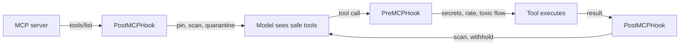

## Overview

An MCP server decides what its tools are called, what their descriptions say, and what comes back from a call. All of that lands in the model's context, and none of it is checked by default. The **MCP Integrity** plugin sits in the gateway and checks it.

| Threat | How the plugin detects it | Finding |
|---|---|---|
| **Rug pull**: a tool changes after you approved it | SHA-256 pin of name, description, input schema and annotations | `tool_changed` (critical) |
| **Tool poisoning**: hidden instructions in a description | Heuristic text scanner | `poisoning_pattern` (`MCPI-001` to `MCPI-010`) |
| **Tool shadowing**: one server's description targets another server's tool | Cross-server name check | `tool_shadowing` (`MCPI-008`) |
| **Poisoned server instructions** | Pin and scan the `initialize` instructions | `instructions_changed` |
| **Malicious first contact** | Ed25519-signed manifest replaces trust on first use | `tool_not_in_manifest` |
| **Prompt injection in tool output** | Scan results, withhold in enforce mode | `result_injection` |
| **Secrets sent to a tool** | Credential patterns in call arguments | `secret_in_arguments` |
| **Runaway agent** | Per-tool call-rate and argument-size baselines | `call_rate_anomaly`, `argument_size_anomaly` |
| **Lethal trifecta** | Session tracking of capability labels | `toxic_flow` |



The plugin uses only the public `MCPPlugin` and `MCPConnectionPlugin` hooks. It changes nothing in core.

<Note>
Start in **monitor** mode. It records findings and never changes behaviour. Move to **enforce** once the findings look right for your servers.
</Note>

---

## Quick start

Add the plugin to `config.json`. MCP clients require a config store.

```json
{
  "config_store": { "enabled": true, "type": "sqlite", "config": { "path": "./config.db" } },
  "mcp": {
    "client_configs": [
      {
        "name": "github",
        "connection_type": "http",
        "connection_string": "https://mcp.example.com/mcp",
        "tools_to_execute": ["*"]
      }
    ]
  },
  "plugins": [
    {
      "enabled": true,
      "name": "mcp-integrity",
      "config": {
        "mode": "monitor",
        "state_file": "./mcp-integrity-pins.json",
        "findings_log": "./mcp-integrity-findings.jsonl",
        "scan_arguments": true,
        "scan_results": true
      }
    }
  ]
}
```

Start the gateway. On the first tool list from each server the plugin pins its tools. Later changes appear in `mcp-integrity-findings.jsonl`.

<Warning>
Without `state_file`, pins live in memory and the next tool list after a restart is trusted again. Set it for any real deployment.
</Warning>

---

## Modes

| Mode | Behaviour |
|---|---|
| `monitor` (default) | Record findings. Never alter tool lists or block calls. |
| `enforce` | Quarantine bad tools: hidden from the model and refused with HTTP 403. Withhold injected results. Refuse calls that leak secrets, exceed rate limits or complete a toxic flow. |

Only findings at or above `block_severity` (default `high`) block. Medium and lower findings are always record-only.

When a tool is quarantined, a call to it returns:

```json
{
  "status_code": 403,
  "error": { "message": "tool call refused by mcp-integrity: quarantined: definition changed since pin" }
}
```

---

## What gets pinned

For each tool the plugin hashes the name, description, input schema, annotations and MCP metadata. Any change to those fields changes the hash. Bifrost-side settings such as cache control are ignored.

The first tool list from a server is trusted (trust on first use). To remove that assumption, see [Signed manifests](#signed-manifests).

A tool added after the first pin is allowed and recorded as `tool_added` (low). Set `on_new_tool` to `quarantine` to hold new tools until an operator approves them.

---

## Toxic flows

The lethal trifecta is a session that can read private data, ingest untrusted content, and send data out. Label your tools and the plugin refuses the dangerous sequence:

```json
{
  "tool_labels": {
    "db-read_customers": ["private_data"],
    "web-*": ["untrusted_content"],
    "mail-*": ["exfil"]
  },
  "infer_labels": true
}
```

By default, a tool labelled `exfil` is refused once the same session has used a `private_data` or `untrusted_content` tool. Set `toxic_flows` for your own `{name, from, to}` rules.

With `infer_labels`, an unlabelled tool whose MCP annotation sets `openWorldHint` is treated as `untrusted_content`, and as `exfil` as well when it is not `readOnlyHint`. This is a heuristic; label sensitive tools explicitly.

Sessions are keyed by virtual key, then MCP session ID, then session ID. Calls with none of these share one `default` session.

---

## Signed manifests

Trust on first use is only as good as the first tool list. To remove that assumption, sign the tool set you vetted.

```bash
go build -o mcpi ./plugins/mcpintegrity/cmd/mcpi
./mcpi keygen -out vendor-key
# run the gateway against the vetted server so it pins, then:
./mcpi sign -state ./mcp-integrity-pins.json -server github -key vendor-key.priv -out github.manifest.json
./mcpi verify -manifest github.manifest.json -pub vendor-key.pub
```

Reference the manifest in the plugin config, using the contents of `vendor-key.pub`:

```json
{
  "manifests": [
    { "server": "github", "path": "./github.manifest.json", "public_key": "<base64 public key>" }
  ]
}
```

A tool missing from the manifest, or different from it, is quarantined even on the first list. A manifest that fails verification stops the plugin from starting.

---

## Configuration reference

| Field | Default | Description |
|---|---|---|
| `mode` | `monitor` | `monitor` or `enforce` |
| `state_file` | none | Persist pins across restarts |
| `block_severity` | `high` | Lowest severity that blocks in enforce mode: `low`, `medium`, `high`, `critical` |
| `on_new_tool` | `allow` | `allow` or `quarantine` for tools added after the first pin |
| `servers` | all | Limit the plugin to the named MCP clients |
| `disable_scanner` | `false` | Keep pinning, skip text scanning |
| `max_description_length` | `2000` | Flag longer tool descriptions. Negative disables. |
| `max_findings` | `1000` | In-memory findings buffer size |
| `findings_log` | none | Append findings as JSON lines |
| `scan_arguments` | `false` | Scan call arguments for secrets and sensitive paths |
| `scan_results` | `false` | Scan tool results for injected instructions and secrets |
| `max_calls_per_minute` | `0` (off) | Per-tool call-rate limit |
| `arg_size_anomaly_factor` | `0` (off) | Flag arguments this many times above the tool's average |
| `tool_labels` | none | Capability labels by exact tool name or `prefix*` |
| `infer_labels` | `false` | Derive labels from MCP annotations |
| `toxic_flows` | built-in pair | Custom `{name, from, to}` rules |
| `session_ttl_seconds` | `1800` | How long a session's label history is kept |
| `manifests` | none | Signed manifests: `{server, path, public_key}` |

Tool names are client-prefixed, as in `github-create_issue`. MCP client names cannot contain hyphens.

---

## Findings

Every finding records its kind, severity, rule, client, tool, a short message and whether it quarantined or blocked. Findings never contain full tool text or secrets: evidence is a short sanitised excerpt, and secrets show only their type and the first four characters.

| Severity | Examples |
|---|---|
| critical | `tool_changed`, `tool_not_in_manifest`, `toxic_flow` |
| high | Instruction override, concealment from the user, credential path with a read or send verb, hidden Unicode, `secret_in_arguments`, `call_rate_anomaly` |
| medium | Pseudo-system tags, encoded blobs, URL with a send instruction, tool shadowing, `argument_size_anomaly` |
| low / info | `tool_added`, oversize description, `tool_removed` |

---

## Operating it

The plugin exposes `(*Plugin).Handler()`, an `http.Handler` for embedding in an admin surface:

| Route | Purpose |
|---|---|
| `GET /findings?min_severity=high&limit=50` | Recent findings, newest first |
| `GET /quarantine` | Currently quarantined tools |
| `GET /pins` | Pinned tools and fingerprints |
| `POST /approve?client=<c>&tool=<t>` | Approve a tool |
| `GET /metrics` | Prometheus counters |

<Warning>
The handler does no authentication. Mount it behind admin auth or on a private listener. `/approve` changes what the model may call.
</Warning>

Approving a tool lifts its quarantine and marks its next-listed definition as reviewed. It is pinned as the new baseline and the scanner stops quarantining that exact definition. The tool reappears at the server's next tool sync (`tool_sync_interval`, a `tools/list_changed` notification, or an explicit refresh).

---

## Limits

- The text scanner is heuristic. It raises the cost of common poisoning but does not stop an attacker who paraphrases well. Pinning and signed manifests are the strong controls.
- Detection speed depends on when the gateway re-lists a server's tools, which is the `tool_sync_interval` unless the server notifies the gateway of changes.
- In trust-on-first-use mode a tool poisoned on first contact is pinned with that definition. Enforce mode still quarantines it, and a signed manifest avoids the problem.
- Pins and findings belong to one gateway process unless `state_file` and `findings_log` are set.

## Cost on the request path

With only pinning enabled, a tool call costs one request-type check. With every check on, a call to a tool with no findings costs a few microseconds and a handful of allocations. Tool-list inspection runs only when a server's tools are fetched. Retained memory is bounded: findings by `max_findings`, tracked tools by 10,000, and sessions by 10,000 with a 30 minute expiry.
