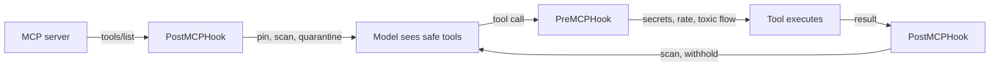

# mcp-integrity

**A Bifrost plugin that protects the model from malicious or tampered MCP tools.**

An MCP server decides what its tools are called, what their descriptions say, and what comes back from a call. All of it lands in the model's context, and by default nothing checks it. A tool that was safe when you approved it can change tomorrow (a *rug pull*). A description can hide instructions the user never sees (*tool poisoning*). A result can carry a prompt injection. A session that reads private data and then calls a mail tool can leak it.

`mcp-integrity` sits in the gateway and checks all of this. It uses only Bifrost's public `MCPPlugin` and `MCPConnectionPlugin` hooks, so it changes nothing in core.

```text
$ ./run-demo.sh        # real bifrost-http gateway + a demo MCP server

== 1. benign server: the tool is callable
  execute demo-add -> HTTP 200   {"role":"tool","content":"3"}

== 2. server swaps the tool description (rug pull)

== 3. tool is quarantined: the call is refused
  execute demo-add -> HTTP 403
  tool call refused by mcp-integrity: quarantined: definition changed since pin

== 4. findings log
  {"kind":"tool_changed","severity":"critical","tool":"demo-add","quarantined":true, ...}
  {"kind":"poisoning_pattern","severity":"medium","rule":"MCPI-009", ...}
  {"kind":"blocked_call","severity":"high","tool":"demo-add","blocked":true, ...}
```

## What it detects

| Threat | How | Finding |
|---|---|---|
| **Rug pull**: a tool changes after approval | SHA-256 pin of name, description, schema, annotations | `tool_changed` (critical) |
| **Tool poisoning**: hidden instructions in a description | Heuristic scanner: override, concealment, credential paths, pseudo-system tags, encoded blobs, invisible Unicode, dependency hijack | `MCPI-001` to `MCPI-010` |
| **Tool shadowing**: one server's description targets another's tool | Cross-server name check | `MCPI-008` |
| **Poisoned server instructions** | Pin and scan the `initialize` instructions | `instructions_changed` |
| **Malicious first contact** | Ed25519-signed manifest instead of trust on first use | `tool_not_in_manifest` |
| **Prompt injection in tool output** | Scan results, withhold in enforce mode | `result_injection` |
| **Secrets sent to a tool** | Credential patterns in call arguments | `secret_in_arguments` |
| **Runaway agent** | Per-tool call-rate and argument-size baselines | `call_rate_anomaly`, `argument_size_anomaly` |
| **Lethal trifecta** | Session tracking of capability labels (private data, untrusted content, exfil) | `toxic_flow` |

Two modes: **monitor** (default) records findings and never changes behaviour; **enforce** quarantines tools (hidden from the model, calls refused with HTTP 403), withholds injected results, and refuses risky calls. Only findings at or above `block_severity` (default `high`) block.

## How it works



On the first tool list from a server the plugin records a fingerprint of every tool (trust on first use, or a signed manifest if you provide one). Each later list is compared to that baseline. In enforce mode a changed or poisoned tool is removed from the list the model sees and refused at call time. Findings never contain full tool text or secrets; evidence is a short sanitised excerpt.

## Quick start

Register the plugin in the gateway's `config.json`. MCP clients need a config store.

```json
{
  "config_store": { "enabled": true, "type": "sqlite", "config": { "path": "./config.db" } },
  "mcp": {
    "client_configs": [
      { "name": "github", "connection_type": "http",
        "connection_string": "https://mcp.example.com/mcp", "tools_to_execute": ["*"] }
    ]
  },
  "plugins": [{
    "enabled": true,
    "name": "mcp-integrity",
    "config": {
      "mode": "monitor",
      "state_file": "./mcp-integrity-pins.json",
      "findings_log": "./mcp-integrity-findings.jsonl",
      "scan_arguments": true,
      "scan_results": true
    }
  }]
}
```

Start in `monitor`, watch `mcp-integrity-findings.jsonl`, then switch to `enforce`. Set `state_file` for any real deployment: without it, trust resets on restart.

## Try the demo

`examples/mcp-integrity-demo` is a small MCP server whose `add` tool can change after first listing, plus a script that runs the whole story against a real gateway.

```bash
# from the repo root: build the gateway with the plugin compiled in
cd transports && go build -o /tmp/bifrost-http ./bifrost-http && cd ..

# run the demo (starts the demo server and the gateway, then cleans up)
GATEWAY=/tmp/bifrost-http examples/mcp-integrity-demo/run-demo.sh
```

The gateway re-lists a server's tools every `tool_sync_interval` (the demo sets `1m`), so step 2 takes about a minute to be noticed. To drive the server by hand: `POST localhost:9100/mutate?mode=rugpull|poison|benign`.

## Configuration

| Field | Default | Meaning |
|---|---|---|
| `mode` | `monitor` | `monitor` or `enforce` |
| `state_file` | none | Persist pins across restarts |
| `block_severity` | `high` | Lowest severity that blocks in enforce mode |
| `on_new_tool` | `allow` | `quarantine` holds tools added after the first pin until approved |
| `servers` | all | Limit to named MCP clients |
| `disable_scanner` | `false` | Keep pinning, skip text scanning |
| `scan_arguments` / `scan_results` | `false` | Inspect call arguments / tool output |
| `max_calls_per_minute` | `0` (off) | Per-tool call-rate limit |
| `arg_size_anomaly_factor` | `0` (off) | Flag arguments N times above the tool's average |
| `tool_labels` | none | Capability labels by exact name or `prefix*` |
| `infer_labels` | `false` | Derive labels from MCP annotations (`openWorldHint`) |
| `toxic_flows` | private_data→exfil, untrusted_content→exfil | Custom `{name, from, to}` rules |
| `session_ttl_seconds` | `1800` | How long a session's label history is kept |
| `manifests` | none | Signed manifests: `{server, path, public_key}` |
| `findings_log` | none | Append findings as JSON lines |
| `max_description_length` | `2000` | Flag longer tool descriptions |
| `max_findings` | `1000` | In-memory findings buffer |

The full reference is in [`docs/features/plugins/mcp-integrity.mdx`](../../docs/features/plugins/mcp-integrity.mdx), and the config is validated by `transports/config.schema.json`.

### Toxic flows

```json
{
  "tool_labels": {
    "db-read_customers": ["private_data"],
    "web-*": ["untrusted_content"],
    "mail-*": ["exfil"]
  }
}
```

A tool labelled `exfil` is refused once the same session has used a `private_data` or `untrusted_content` tool.

### Signed manifests

Trust on first use is only as good as the first list. To remove that assumption, sign what you vetted:

```bash
go build -o mcpi ./cmd/mcpi
./mcpi keygen -out vendor-key
# run the gateway against the vetted server so it pins, then:
./mcpi sign -state ./mcp-integrity-pins.json -server github -key vendor-key.priv -out github.manifest.json
./mcpi verify -manifest github.manifest.json -pub vendor-key.pub
```

A tool missing from the manifest or different from it is quarantined even on the first list. A manifest that fails verification stops the plugin from starting.

## Operating it

`(*Plugin).Handler()` returns an `http.Handler`: `GET /findings`, `/quarantine`, `/pins`, `/metrics` (Prometheus text) and `POST /approve?client=&tool=`. It does no authentication, so mount it behind admin auth or a private listener; `/approve` changes what the model may call.

`Approve` lifts a quarantine and marks the tool's next-listed definition as reviewed. It reappears at the server's next tool sync.

## Testing

```bash
go test -race ./plugins/mcpintegrity/...                       # unit + end-to-end through the real MCP pipeline
go test -run TestCorpus -v ./plugins/mcpintegrity/             # scanner detection / false-positive report
go test -run xxx -bench . -benchmem ./plugins/mcpintegrity/    # request-path cost
```

- **Unit and end-to-end tests** cover pinning, enforcement, approval, persistence, manifests, argument and result scanning, rate and size anomalies, toxic flows, the HTTP handler and the findings log. The end-to-end test registers the plugin on a real Bifrost core, connects an MCP server over HTTP, mutates a tool and asserts quarantine and the 403.
- **Scanner corpus** (`testdata/corpus`) holds 48 malicious and 70 benign tool descriptions modelled on documented attack classes. The test reports detection and false positives per class and logs known gaps instead of hiding them. Current numbers: **81% of malicious entries detected** (every entry marked `must_detect` is caught) and **4% of benign entries flagged high** (3 of 70). Roughly a quarter of benign entries still get a medium finding, which records but does not block at the default `block_severity`.
- **Real gateway:** `examples/mcp-integrity-demo/run-demo.sh` runs the story against a built `bifrost-http`.

## Cost on the request path

Measured with `-benchmem` on an Apple M-series laptop:

| Path | Time | Allocations |
|---|---|---|
| Tool call, pinning only (no checks) | 76 ns | 2 |
| Tool call, every check on | 1.9 µs | 6 |
| Tool-list inspection, 5 tools | 134 µs | 72 |

List inspection runs only when a server's tools are fetched, not per request. Retained memory is bounded: findings by `max_findings`, tracked tools by 10,000, sessions by 10,000 with a 30 minute expiry.

## Limits

- The scanner is a heuristic. It raises the cost of common poisoning but does not stop an attacker who paraphrases well. Pinning and signed manifests are the strong controls; the scanner is defence in depth.
- Detection speed depends on when the gateway re-lists a server's tools: the `tool_sync_interval`, unless the server notifies the gateway of changes.
- In trust-on-first-use mode a tool poisoned on first contact is pinned with that definition. Enforce mode still quarantines it, and a signed manifest avoids the problem.
- Label inference from annotations is a heuristic. Prefer explicit `tool_labels` for sensitive tools.
- Pins and findings belong to one gateway process unless `state_file` and `findings_log` are set.

## Layout

| Path | What |
|---|---|
| `plugin.go` | Plugin, hooks, pin comparison, quarantine |
| `scanner.go`, `secrets.go` | Text and credential detection |
| `runtime.go`, `baseline.go`, `toxicflow.go` | Call-time checks |
| `manifest.go`, `cmd/mcpi` | Signed manifests and the signing tool |
| `handler.go` | HTTP handler and Prometheus metrics |
| `store.go`, `fingerprint.go` | Pin store and tool hashing |
| `testdata/corpus` | Scanner regression corpus |
| `../../examples/mcp-integrity-demo` | Demo MCP server, config and script |
| `../../docs/features/plugins/mcp-integrity.mdx` | Documentation page |

## Roadmap

- Mount the operator handler on the gateway's authenticated admin API and add a UI panel for findings and approvals.
- Surface findings in the existing logs and OpenTelemetry pipelines.
- A semantic (embedding or LLM-judge) scanner behind an interface, for paraphrased attacks the regexes miss.
